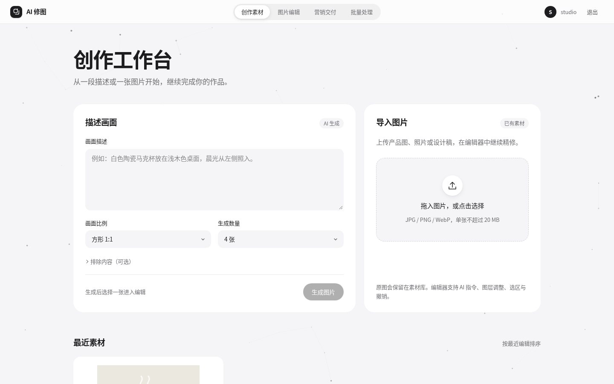
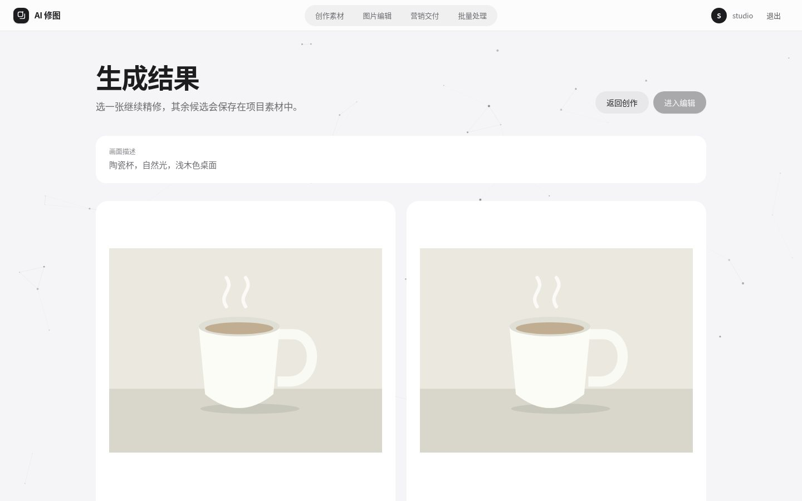
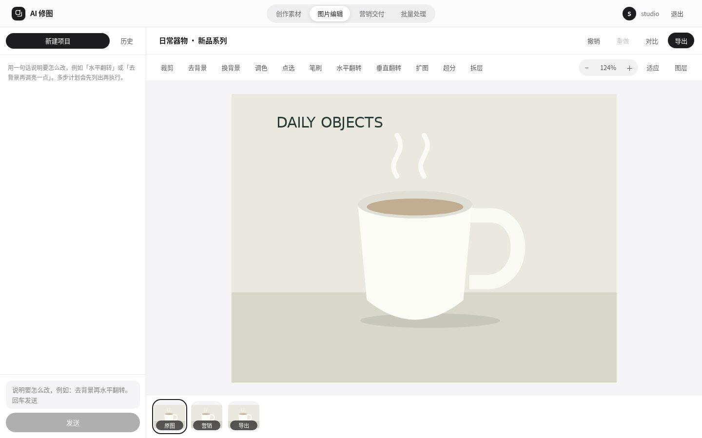
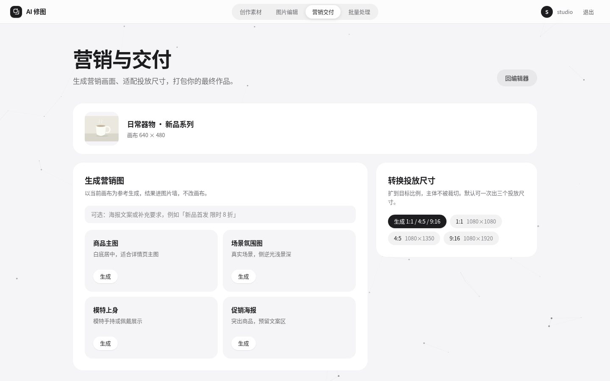
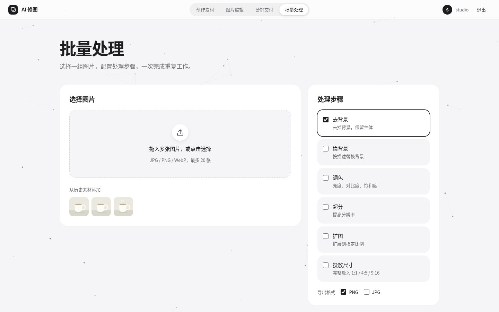
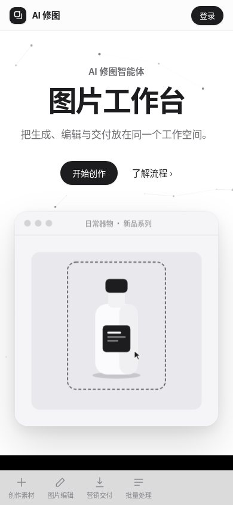
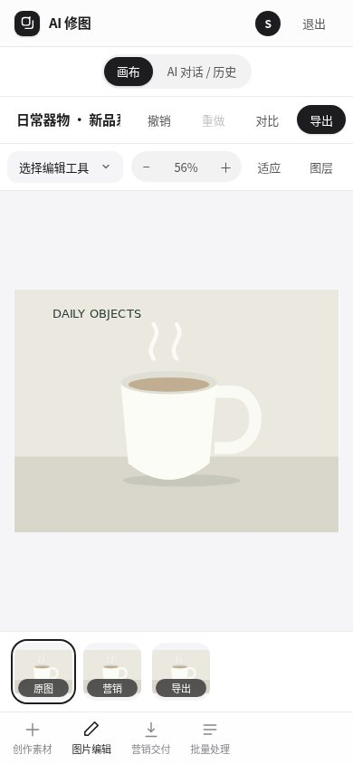
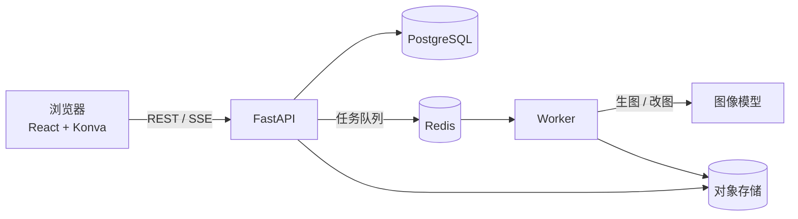

<p align="center">
  
</p>

<h1 align="center">AI 修图智能体</h1>

<p align="center">
  <b>图片工作台。</b><br />
  把生成、编辑与交付放在同一个工作空间：一句话出图，画布上精修，再批量导出成各种投放尺寸。
</p>

<p align="center">
  <a href="https://retouch.xiaoxy.com/"></a>
  
  
  
  
  
  <a href="LICENSE"></a>
</p>

<p align="center">
  <a href="https://retouch.xiaoxy.com/"><b>打开 AI 修图 →</b></a>
</p>

<p align="center">
  
</p>
<p align="center"><sub>首页演示：说一句“去掉背景，换成深色”，再加一行标题</sub></p>

## 一条完整的修图流程

### 创作素材：一句话出图

写一段画面描述，选好比例和数量，一次生成多张候选；也可以直接上传产品图、照片或设计稿，进编辑器继续处理。

<p align="center">
  
  
</p>

### 图片编辑：画布上修，也可以直接说



- **手动精修**：缩放平移、裁剪、调色、文字、图层、选区，随时撤销和重做。
- **AI 修图**：去背景、换背景、局部编辑、扩图、超分辨率、图层拆分。
- **先看计划再动手**：用自然语言说要改什么，AI 先给出分步计划，你确认后才执行，进度实时可见。

### 营销交付：一张图，多种用法



以当前画面为参考生成商品主图、场景氛围图、模特上身图和促销海报，一次转换成 1:1、4:5、9:16 等投放尺寸。

### 批量处理：一组图，一次做完



选一组图片，勾选要做的步骤（去背景、换背景、调色、超分、扩图、投放尺寸），一次处理完，打包下载。

## 在手机上，也一样能用

<p align="center">
  
  &nbsp;&nbsp;
  
</p>

<p align="center"><sub>截图使用项目自带的示例数据。</sub></p>

## 技术栈

| 层 | 选型 |
| --- | --- |
| 前端 | React · TypeScript · Konva 画布 · Vite |
| 后端 | Python 3.13 · FastAPI · SQLAlchemy · Alembic |
| 任务 | arq Worker 执行耗时任务，进度通过 SSE 实时推送 |
| 存储 | PostgreSQL · Redis · S3 兼容对象存储（如 MinIO） |
| 模型 | 通义千问图像模型，或任意 OpenAI 兼容的图像接口；本地抠图用 rembg |



## 快速开始

需要 Docker（含 Compose）、Python 3.13，以及 Node.js 20.19 或 22.12 以上。

```bash
cp -n .env.example .env          # 默认 IMAGE_PROVIDER=mock，用占位图，不产生调用费用
docker compose up -d             # 启动 PostgreSQL、Redis、MinIO

cd backend
uv sync --frozen --all-extras
uv run alembic upgrade head
uv run uvicorn app.main:app --reload --port 7302   # 终端一：API
uv run arq app.worker.WorkerSettings               # 终端二：Worker

cd ../frontend
npm ci && npm run dev                              # 终端三：前端
```

打开 <http://localhost:7301> 即可使用。接真实模型、运行测试和部署上线见 [开发文档](docs/development.md)。

## 文档

- [开发文档](docs/development.md)：配置、启动、测试与部署
- [功能范围与验证记录](docs/spec.md) · [界面风格](docs/design.md) · [重构记录](docs/NOTES.md)
- [开发约定](AGENTS.md)

## 许可证

[MIT](LICENSE) © 2026 hollegjx
